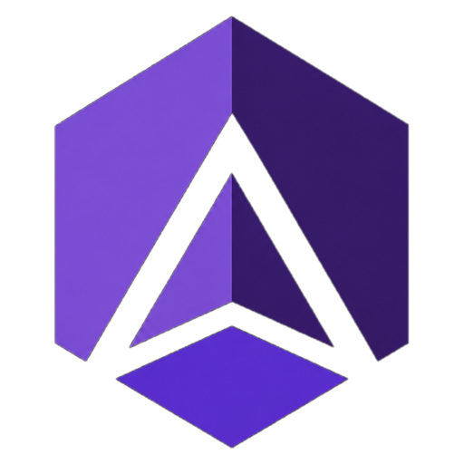
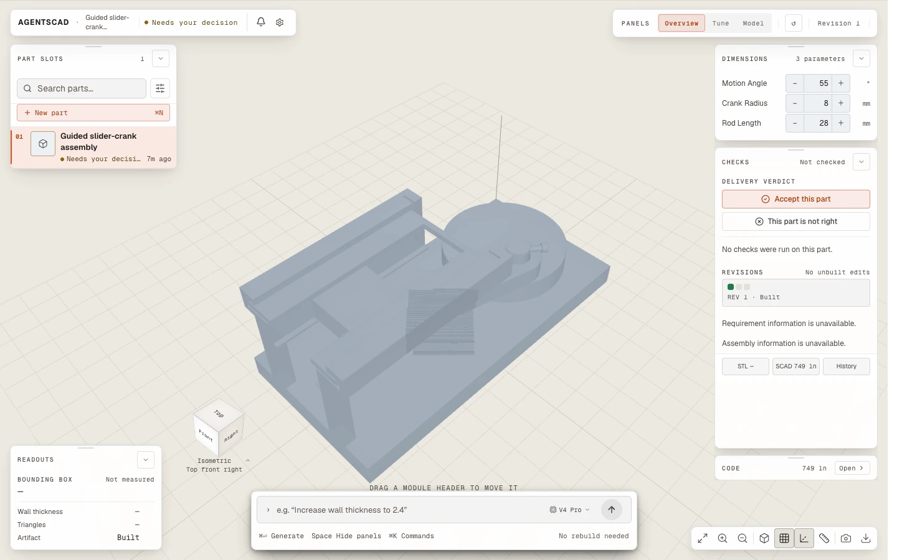
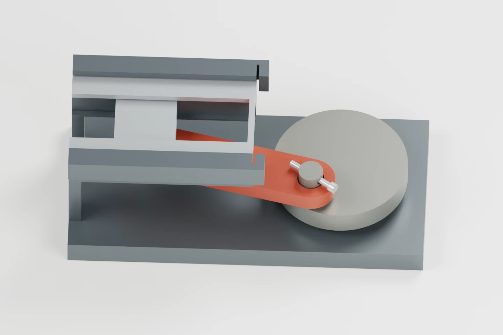

**English** | [中文](./README_CN.md)

<p align="center">
  
</p>

<h1 align="center">AgentSCAD</h1>

<p align="center">
  <strong>Describe a part in one sentence. Get editable CAD, real geometry, and checks you can measure.</strong>
</p>

<p align="center">
  <a href="https://agentscad.vercel.app"></a>
  
  
</p>



AgentSCAD is a local-first, open-source AI CAD workspace. A natural-language request becomes editable parametric OpenSCAD, rendered by a real geometry engine and checked by deterministic code instead of by asking a model whether it looks right.

**Live demo:** [agentscad.vercel.app](https://agentscad.vercel.app)

## What it does

- **Writes OpenSCAD, not a mesh.** You get source you can read, edit, re-parameterise and re-export as STL.
- **Checks geometry with code.** Manifoldness, wall thickness, bounds, hole connectivity and clearance are measured on the actual mesh.
- **Stops when the request is ambiguous.** Two plausible readings means it asks, rather than silently picking one.
- **Keeps facts apart from opinions.** `DELIVERED` means the artifacts exist. Whether you accepted the part is a separate, append-only record.



**Slider-crank benchmark prompt**

```text
Build a single-cylinder slider-crank with an 8 mm crank and a 28 mm rod, plus an eccentric retaining key and a front guide. A correct removal takes the guide before the key; the wrong order must be blocked by the guide. All six parts must export separately.
```

[See how AgentSCAD presents an ambiguous request for review.](./docs/images/human_review.png)

## Quick start

Prerequisites: [Bun](https://bun.sh) and the [OpenSCAD CLI](https://openscad.org/downloads.html) available as `openscad` on your `PATH` (or set `OPENSCAD_BIN`). Local rendering uses native OpenSCAD by default; serverless builds use the pinned WASM runtime. Installation steps are in [Development](./docs/DEVELOPMENT.md).

```bash
git clone https://github.com/Kevoyuan/AgentSCAD.git
cd AgentSCAD
bun install
cp .env.example .env
bun run db:push
bun run dev
```

Open [http://localhost:3000](http://localhost:3000), then **Settings ⚙️ → Providers**: pick a preset, paste a key, **Test**, **Save**. Keys stay on your machine.

[View the provider settings screenshot.](./docs/images/providers.png)

No Bun? `cp .env.example .env && docker compose up --build`.

Then describe a part and press `⌘/Ctrl + Enter`:

```text
Create a wall-mountable phone holder with rounded corners and two screw holes.
```

You can then nudge the extracted dimensions with the parameter steppers and rebuild without another model call.

## Why it is different

Most text-to-CAD demos stop at "the shape looks right". The interesting part of CAD is what can be measured afterwards, so that is where the effort went:

- A **deterministic verifier** measures the rendered mesh: the clearance between a bore and a shaft, collision across a sampled motion sweep, whether a part can actually be withdrawn.
- A **public benchmark** for functional assemblies — thirteen native families (hinges, slider-cranks, inline twin and 90° V-twin, V8 packaging, planetary trains, threads, cam), twelve evidence layers, and adversarial submissions in every family. The self-check fails if a cheat starts passing.
  → [`bench/`](./bench/README.md)

## Status & limits

AgentSCAD is under active development (v0.6). It is local-first and has no account system; provider keys stay in your browser or on your machine.

- `DELIVERED` means the artifacts exist — not that the part was accepted or matches your intent. Acceptance is recorded separately in the outcome ledger.
- Assembly evidence is **sampled and version-bound**. A clear sample is not proof of continuous motion, physical fit or manufacturing success; unresolved checks stay `NOT_RUN`.
- Functional assembly (A01–A14) is still in progress; see the [execution ledger](./docs/ASSEMBLY_EXECUTION_BACKLOG.md) and [plan](./docs/FUNCTIONAL_ASSEMBLY_PLAN.md) for what is currently gated.

## Documentation

- [Architecture](./docs/ARCHITECTURE.md)
- [Benchmark](./bench/README.md) · [Evaluation commands](./docs/BENCHMARK.md)
- [Functional assembly target](./docs/FUNCTIONAL_ASSEMBLY_PLAN.md) (中文)
- [Skills and routing](./docs/SKILLS.md) · [Development and CI](./docs/DEVELOPMENT.md)
- [Design system](./DESIGN.md) · [Changelog](./CHANGELOG.md) · [Contributing](./CONTRIBUTING.md)

## Commands

| Task | Command |
| :--- | :--- |
| Dev server | `bun run dev` |
| Production build | `bun run build` |
| Unit tests | `bun run test` |
| Assembly benchmark self-check (13 families) | `bun run bench:all` |
| Reset database | `bun run db:reset` |

More in [`docs/DEVELOPMENT.md`](./docs/DEVELOPMENT.md). In the app, `⌘/Ctrl + K` opens the command palette and `Space` hides every panel for a clean 3D view.

## License

MIT — see [LICENSE](./LICENSE).
