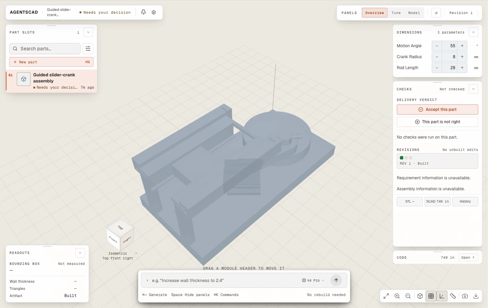
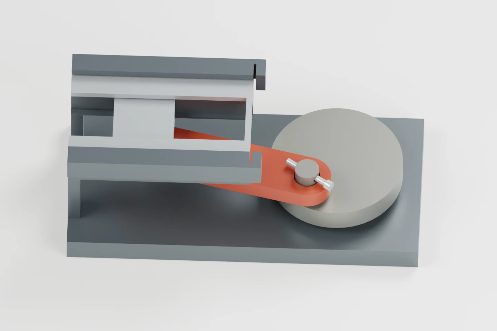

[English](./README.md) | **中文**

<p align="center">
  
</p>

<h1 align="center">AgentSCAD</h1>

<p align="center">
  <strong>用一句话描述零件，得到可编辑的 CAD、真实的几何，以及能被测量的检查结果。</strong>
</p>

<p align="center">
  <a href="https://agentscad.vercel.app"></a>
  
  
</p>



AgentSCAD 是一个本地优先的开源 AI CAD 工作区。一句自然语言需求会变成可编辑的参数化 OpenSCAD，由真实的几何引擎渲染，并由确定性代码检查——而不是问模型"看起来对不对"。

**在线演示：** [agentscad.vercel.app](https://agentscad.vercel.app)

## 它做什么

- **写的是 OpenSCAD，不是网格。** 你拿到的是可读、可改、可重新参数化、可再导出 STL 的源码。
- **用代码检查几何。** 流形性、最小壁厚、外形尺寸、孔连通性、配合间隙，都在真实网格上测量。
- **需求有歧义时停下来问。** 有两种合理解读时它会提问，而不是替你选一个。
- **事实和判断分开记。** `DELIVERED` 只表示产物存在；你是否接受了这个零件，是另一份只追加的记录。



**滑块曲柄评测提示词（英文原文）**

```text
Build a single-cylinder slider-crank with an 8 mm crank and a 28 mm rod, plus an eccentric retaining key and a front guide. A correct removal takes the guide before the key; the wrong order must be blocked by the guide. All six parts must export separately.
```

[查看 AgentSCAD 如何提示用户确认有歧义的需求。](./docs/images/human_review.png)

## 快速开始

前置条件：[Bun](https://bun.sh)，以及可在 `PATH` 中直接调用的 [OpenSCAD CLI](https://openscad.org/downloads.html)（也可设置 `OPENSCAD_BIN`）。本地渲染默认使用原生 OpenSCAD；Serverless 构建使用校验和锁定的 WASM 运行时。安装步骤见[开发文档](./docs/DEVELOPMENT.md)。

```bash
git clone https://github.com/Kevoyuan/AgentSCAD.git
cd AgentSCAD
bun install
cp .env.example .env
bun run db:push
bun run dev
```

打开 [http://localhost:3000](http://localhost:3000)，然后 **设置 ⚙️ → Providers**：选一个预设，粘贴 API key，**测试**，**保存**。密钥只留在你本机。

[查看 Provider 设置截图。](./docs/images/providers.png)

没有 Bun？`cp .env.example .env && docker compose up --build`。

然后描述一个零件，按 `⌘/Ctrl + Enter`：

```text
做一个可壁挂的手机支架，圆角，开两个螺丝孔。
```

之后可以用参数步进器微调提取出的尺寸，不调用模型也能重建。

## 为什么不一样

大多数 text-to-CAD 演示停在"形状看着对"。CAD 里真正有意思的是**之后还能测量什么**，所以力气花在那里：

- **确定性验证器**直接测量渲染出的网格：轴与孔的直径间隙、采样运动扫掠中是否碰撞、零件能否真的抽出。
- **公开的功能装配评测**——13 个原生家族（铰链、曲柄滑块、直列双缸与 90° V 型双缸、V8 相位封装、行星轮系、螺纹、凸轮）、12 层证据模型，每个家族都有作弊提交；只要有作弊解开始通过，自检就失败。
  → [`bench/`](./bench/README.md)

## 现状与边界

AgentSCAD 仍在积极开发中（v0.6）。它是本地优先的，没有账号体系；provider 密钥只留在你的浏览器或本机。

- `DELIVERED` 只表示产物存在，**不**代表零件已被接受或符合你的意图。接受与否单独记录在结果账本中。
- 装配证据是**采样的、与版本绑定的**。某个采样点通过不等于连续运动、实际配合或制造成功；无法确定的检查保持 `NOT_RUN`。
- 功能装配（A01–A14）仍在进行中；当前哪些环节受证据门控，见[执行台账](./docs/ASSEMBLY_EXECUTION_BACKLOG.md)和[执行计划](./docs/FUNCTIONAL_ASSEMBLY_PLAN.md)。

## 文档

- [架构](./docs/ARCHITECTURE.md)
- [评测](./bench/README.md) · [评测命令](./docs/BENCHMARK.md)
- [功能装配目标与执行计划](./docs/FUNCTIONAL_ASSEMBLY_PLAN.md)
- [技能与路由](./docs/SKILLS.md) · [开发与 CI](./docs/DEVELOPMENT.md)
- [设计系统](./DESIGN.md) · [更新日志](./CHANGELOG.md) · [贡献指南](./CONTRIBUTING.md)

## 常用命令

| 任务 | 命令 |
| :--- | :--- |
| 开发服务器 | `bun run dev` |
| 生产构建 | `bun run build` |
| 单元测试 | `bun run test` |
| 装配评测自检（13 个家族） | `bun run bench:all` |
| 重置数据库 | `bun run db:reset` |

更多见 [`docs/DEVELOPMENT.md`](./docs/DEVELOPMENT.md)。应用内 `⌘/Ctrl + K` 打开命令面板，`Space` 收起全部面板以获得干净的 3D 视图。

## 许可证

MIT — 见 [LICENSE](./LICENSE)。
